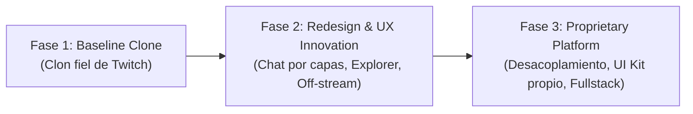

# PRD (Product Requirements Document) & Índice Maestro

> **Proyecto:** Twitch Redesign & Streaming Platform Engine  
> **Estado:** Fase 1 — Baseline Clone & Arquitectura Base  
> **Autor / Product Owner:** vandalit  
> **Última actualización:** Octubre 2026  

---

## 1. Índice de Documentación del Proyecto

Este PRD actúa como documento central e índice de la arquitectura conceptual y técnica. La documentación se encuentra modularizada en los siguientes documentos especializados:

* 📄 **[Propuesta de Innovación UX & Rediseño](./propuesta-ux.md):** Diagnóstico de fricciones en Twitch, propuesta del chat por capas y velocidades, descubrimiento dinámico de contenido e interacciones off-stream.
* 🛠️ **[Estrategia Técnica & Arquitectura](./estrategia-desarrollo.md):** Selección de stack (benchmarking Twitch vs. Kick vs. Propuesta), arquitectura modular orientada a Design System, gestión de estado para chat de alta concurrencia y plan de desacoplamiento para producto propio.
* 🗺️ **[Roadmap por Etapas & Entregables](./roadmap.md):** Fases 1 a 3, hitos detallados, métricas de aceptación y backlog priorizado.

---

## 2. Resumen Ejecutivo (Executive Summary)

El proyecto nace con un doble propósito estratégico:
1. **Case Study & Redesign de Twitch:** Investigar y solucionar fallas críticas de experiencia de usuario en la plataforma líder de live-streaming (chat inmanejable en canales masivos, descubrimiento rígido/enterrado y experiencia estéril en horarios *off-stream*).
2. **Plataforma Propia / Propuesta de Valor Comercial:** Desarrollar un clon inicial con una arquitectura frontend limpia, profesional y modularizada. Este andamiaje servirá primero como *baseline* para pruebas de usabilidad y comparativa, y posteriormente como el núcleo (front engine) de una solución de streaming propia o vendible a competidores de la industria (p. ej. Kick, Twitch o startups de streaming).

---

## 3. Problemas Clave a Resolver (Problem Statement)

| # | Problema Actual en Twitch | Impacto en el Usuario | Propuesta de Solución |
|---|---|---|---|
| **P1** | **Chat Caótico y Monolítico** | En streams masivos (>5k viewers), los mensajes pasan a velocidad ilegible. Mods, VIPs, suscriptores y espectadores comunes compiten por la misma columna vertical de texto. | **Chat por Capas y Control de Velocidad:** Filtros por jerarquía de roles, carriles visuales o sub-canales, y buffers inteligentes con pausas contextuales. |
| **P2** | **Descubrimiento de Contenido Rígido** | La exploración depende de directorios estáticos ordenados por espectadores decrecientes, enterrando canales medianos/pequeños y clips de calidad. | **Exploración Contextual y Fluida:** Feed interactivo con previsualizaciones dinámicas, filtros multidimensionales y grafos de afinidad de comunidades. |
| **P3** | **Experiencia Off-Stream Vacía** | Cuando un creador no está transmitiendo, su canal es una pantalla negra inerte. La visualización de clips y VODs está segregada y tiene poca retención. | **Ecosistema Off-Stream Continuo:** Canal reactivo con carruseles de mejores momentos, comunidad activa asíncrona y visualizador tipo reel/feed de clips. |

---

## 4. Usuarios Objetivo y Personas

* **Viewer Casual:** Busca entretenimiento rápido, navegación ágil entre categorías y clips sin fricción.
* **Viewer Dedicado (Sub / VIP):** Busca sentirse reconocido, interactuar con el streamer y su comunidad sin perder su mensaje en un mar de spam.
* **Moderador / Creator:** Requiere herramientas de visibilidad de infracciones, lectura rápida de preguntas importantes y gestión de comunidad sin sobrecarga cognitiva.

---

## 5. Alcance por Fases (Phased Scope)

### Fase 1: Baseline Twitch Clone (Objetivo Actual)
* **Objetivo:** Maquetar y conectar un frontend de alta fidelidad que replique el comportamiento, navegación y layout de Twitch actual para usarlo como punto cero de medición y base estructural.
* **Módulos Core:**
  * **Top Navigation:** Barra de búsqueda, accesos a categorías, notificaciones, perfil mock.
  * **Sidebar (Canales Seguidos / Recomendados):** Estados contraído y expandido, badges de "Live", conteo de viewers y avatares.
  * **Canal / Live Page:**
    * Reproductor de video (mock dinámico con video loop / HLS de prueba).
    * Metadata del canal (streamer, título, categoría, tags, botones de acción: Follow, Sub, Share).
    * Columna de Chat: Renderizado continuo con mensajes simulados, insignias de rol (mod, sub, vip, viewer) y caja de entrada de mensaje.
  * **Explorar / Directorio:** Grilla de categorías principales con tags y conteo en vivo.
  * **Canal Off-stream & Clips:** Vista de canal sin transmisión con reproductor de clips destacados.

### Fase 2: Rediseño & Propuesta de Valor UX
* Implementación del selector de vistas del chat (Vista Unificada vs. Vista por Capas).
* Módulo de velocidad adaptativa del chat (Smart Slowdown / High-priority ticker).
* Rediseño del directorio de categorías con filtros de micro-intereses y previsualizaciones sin clic.
* Hub off-stream interactivo en la vista de canal.

### Fase 3: Transición a Producto Propio
* Extracción del sistema de componentes a un Design System neutro/independiente.
* Adaptación de branding y tokens de diseño (temas, colores, tipografía).
* Integración con backend real (WebSockets para chat, Auth, Webhooks, API de streaming WebRTC/HLS).

---

## 6. Requisitos No Funcionales (NFR)

* **Rendimiento de Renderizado:** El componente de chat debe soportar ráfagas de 30 a 60 mensajes por segundo sin degradar los 60 FPS de la aplicación (mediante virtualización de listas).
* **Modularidad y Desacoplamiento:** Componentes desacoplados de la marca Twitch (aislamiento de tokens mediante CSS variables y abstracciones de servicios).
* **Responsividad:** Soporte completo para pantallas Ultra-Wide, Desktop estándar (1080p) y Laptop (1366x768 / 1440x900).
* **Navegación Fluida (SPA):** Transición instantánea entre canales y directorios sin reinicio completo del estado global.

---

## 7. Criterios de Éxito de la Fase 1
1. Clon funcional navegable con persistencia de estado local (rutas `/`, `/[username]`, `/directory`, `/clip/[id]`).
2. Generador mock de chat realista con diferentes roles interactuando en tiempo real.
3. Arquitectura de carpetas limpia y preparada para inyectar las características de la Fase 2 sin reescribir la base.
